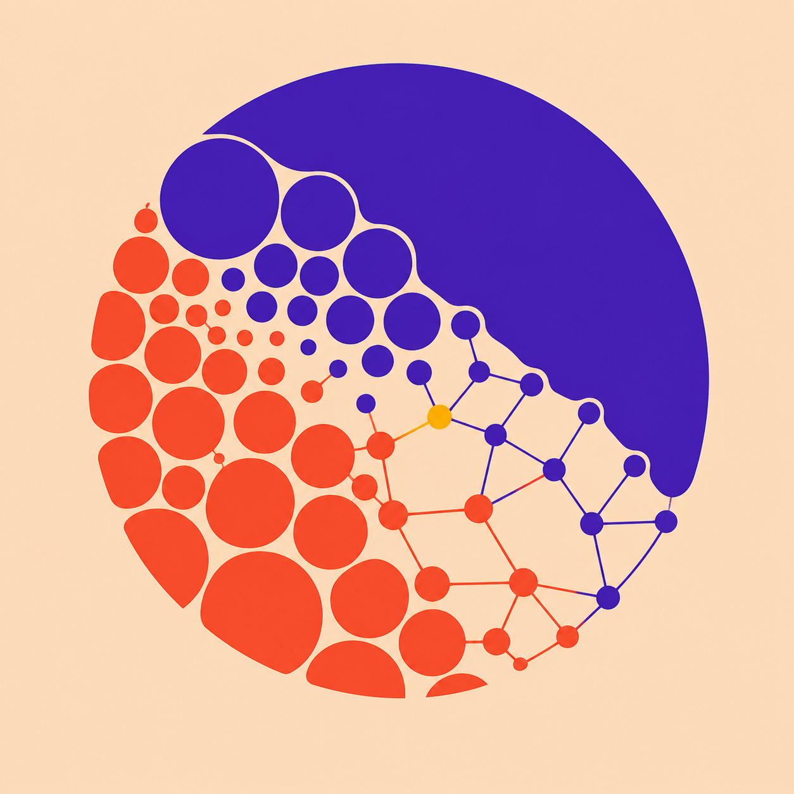
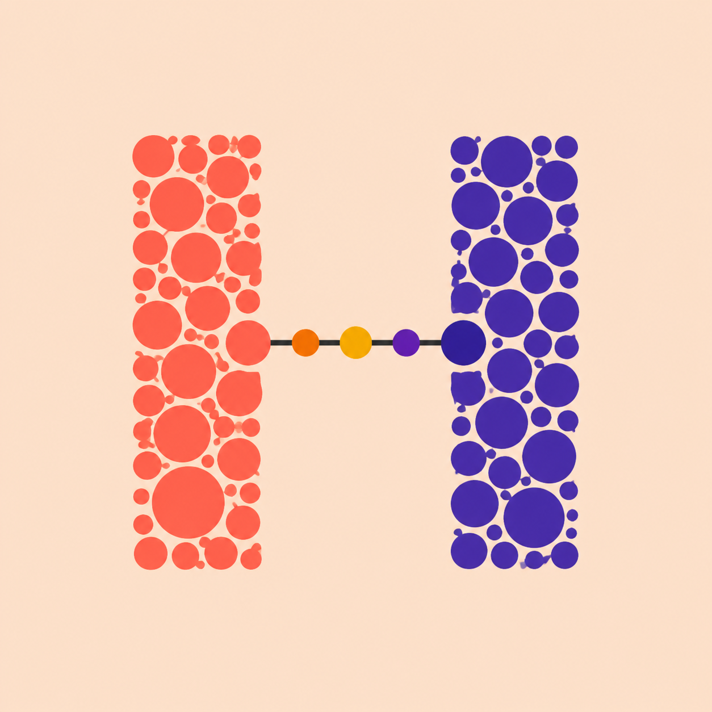
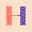
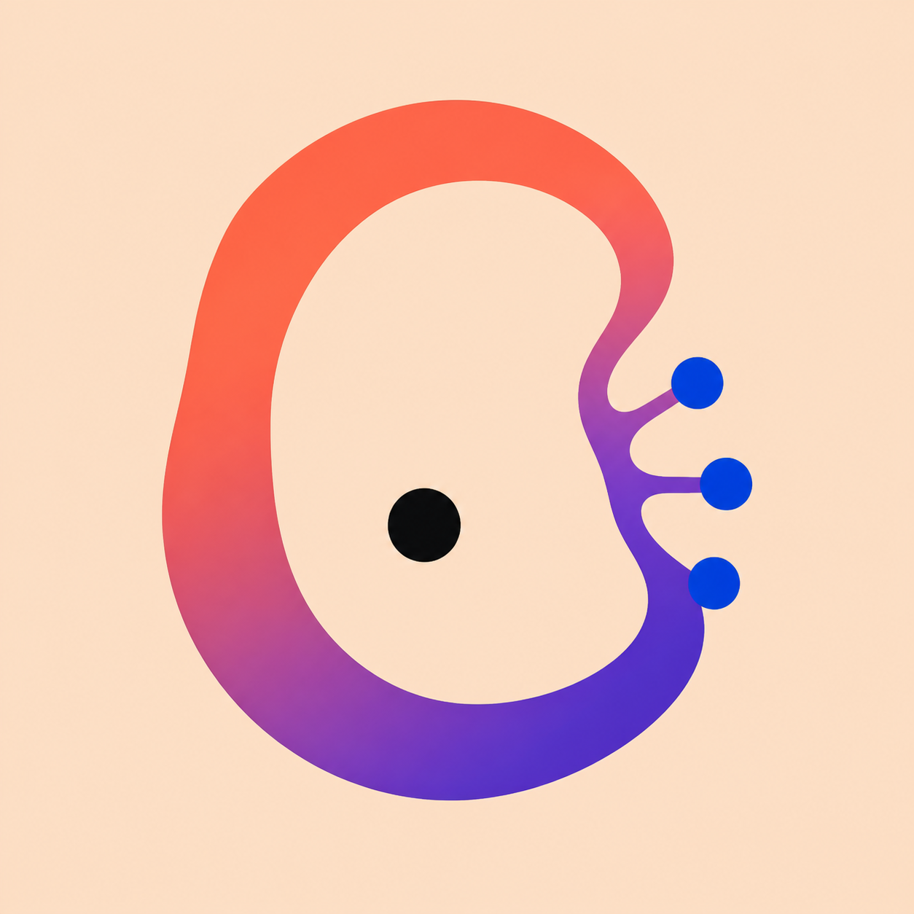
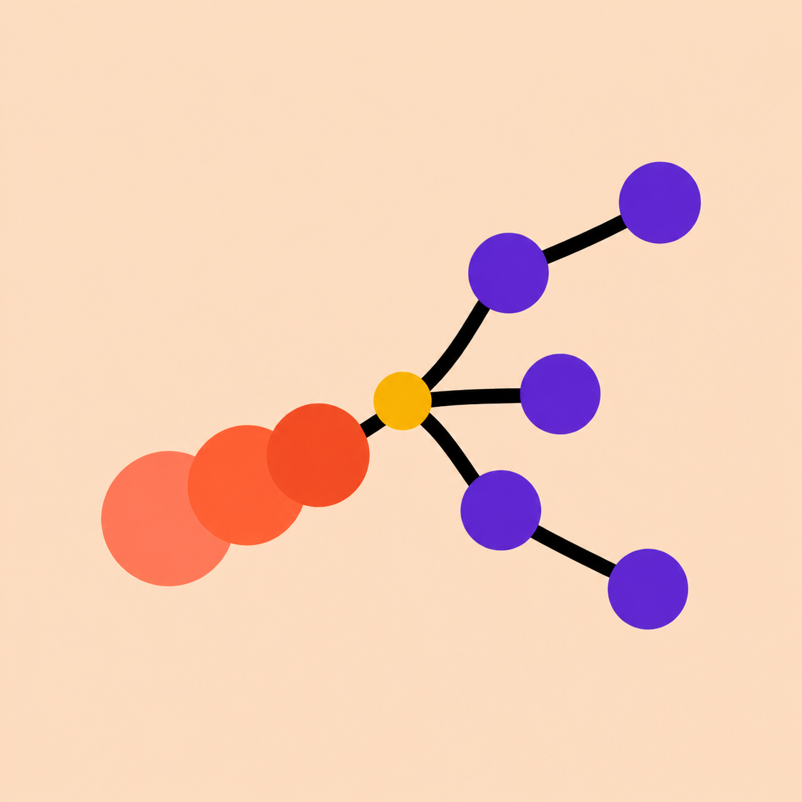
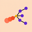

# Favicon options

These are selection concepts generated from the Chromatic Morphogenesis
direction. They are intentionally stored as concept PNGs, not production
favicons. After selection, redraw the chosen mark as a deliberate flat SVG and
validate it at actual browser sizes.

## A — The Ecotone

The richest connection to the homepage: coral and violet territories meet as
cells and graph nodes. It carries the most meaning but loses the most detail at
small sizes.

Actual-size preview: 

## B — The Living H

The most immediately identifiable personal mark. Two cellular cultures form an
H and connect through a short node bridge. It should reduce well after a vector
redraw.

Actual-size preview: 

## C — The Morphogen Seed

The most organic and emblematic option: an incomplete living ring becomes
three graph nodes around a dark nucleus. It evokes emergence and Womb without
literal anatomy.

Actual-size preview: 

## D — Cell Becomes Graph

The most direct expression of the core visual grammar. Three coral cells pass
through a gold transition and become a sparse violet graph. It is legible but
may resemble a generic network mark unless the redraw gives it a distinctive
silhouette.

Actual-size preview: 

## Selection note

Evaluate the idea and silhouette, not the generated gradients or exact
geometry. Those will not be preserved in the production redraw.

## Follow-up: bolder Living H studies

After selecting the Living H as the strongest initial direction, a second round
explored four much simpler marks and tested each at both 32 px and 16 px. See
[Bold H favicon studies — round 2](bold-h-round-2/README.md).

A third round restored the cellular territories and organic growth language
while retaining a dominant favicon-scale silhouette. See
[Living H favicon studies — round 3](living-h-round-3/README.md).
