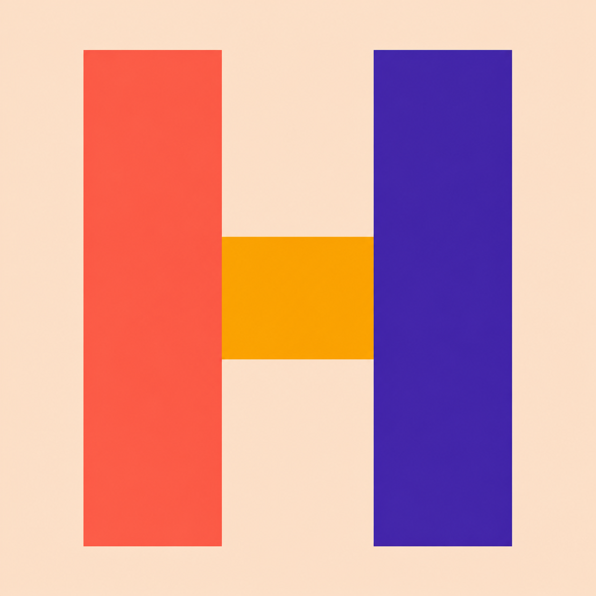
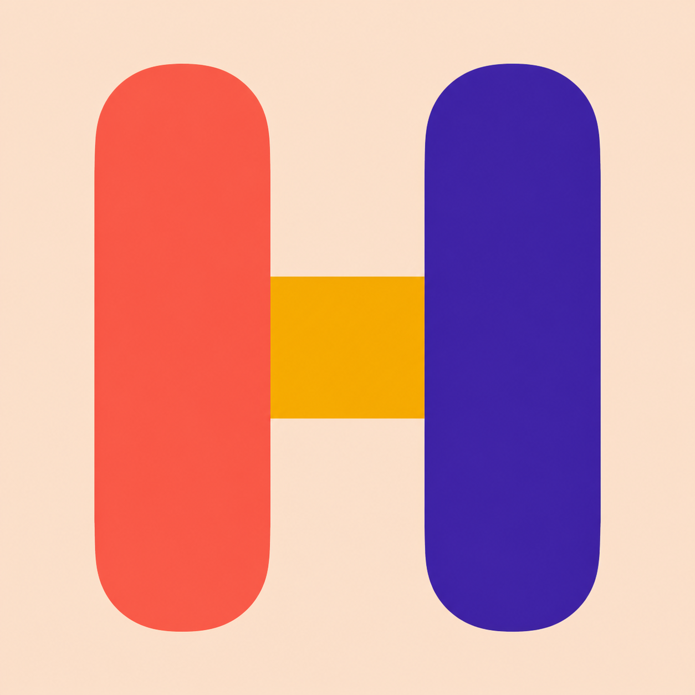
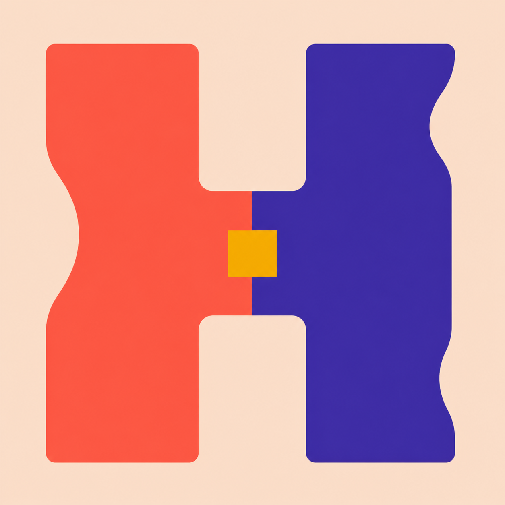

# Bold H favicon studies — round 2

These four concepts respond to Hank's preference for **B — The Living H**, with
an explicit requirement to make the mark much bolder, simpler, and more iconic
at browser-tab sizes.

The large PNGs are concept renders. The `previews-32px/` and `previews-16px/`
directories are actual reductions, not enlarged simulations. Judge the favicon
from those files first.

## 01 — Three-shape monolith

Exactly two vertical color slabs and one gold bridge. It remains readable at
16 px, but is intentionally archetypal rather than highly ownable.

32 px: 
16 px: 

## 02 — Rounded pillars

The friendliest and most reduced study. At 16 px, however, it can read as two
pills, a pause symbol, or a dumbbell before it reads as an H.

32 px: 
16 px: 

## 03 — Negative-space badge

The strongest pure favicon in this round. The dark container gives it a stable
outer silhouette, the cream H survives cleanly at 16 px, and the two color
fields retain the coral/violet polarity without becoming texture.

32 px: 
16 px: 

## 04 — Grown split H

The most distinctive and conceptually faithful study: a single H that feels
grown rather than typeset. It still reads at 16 px, though the pinched center
and gold accent need careful optical tuning in a final redraw.

32 px: 
16 px: 

## Recommendation

Use **03** if tab-size clarity is the overriding criterion. Use **04** if a
slightly less severe reduction is worth the more ownable, living silhouette.
Either selected concept should be manually redrawn as a flat SVG, then
pixel-tuned independently at 16 px and 32 px. Do not auto-trace the generated
raster, preserve its incidental gradients, or add back small cellular detail.

The exact generation prompts are archived in [prompts.md](prompts.md).
