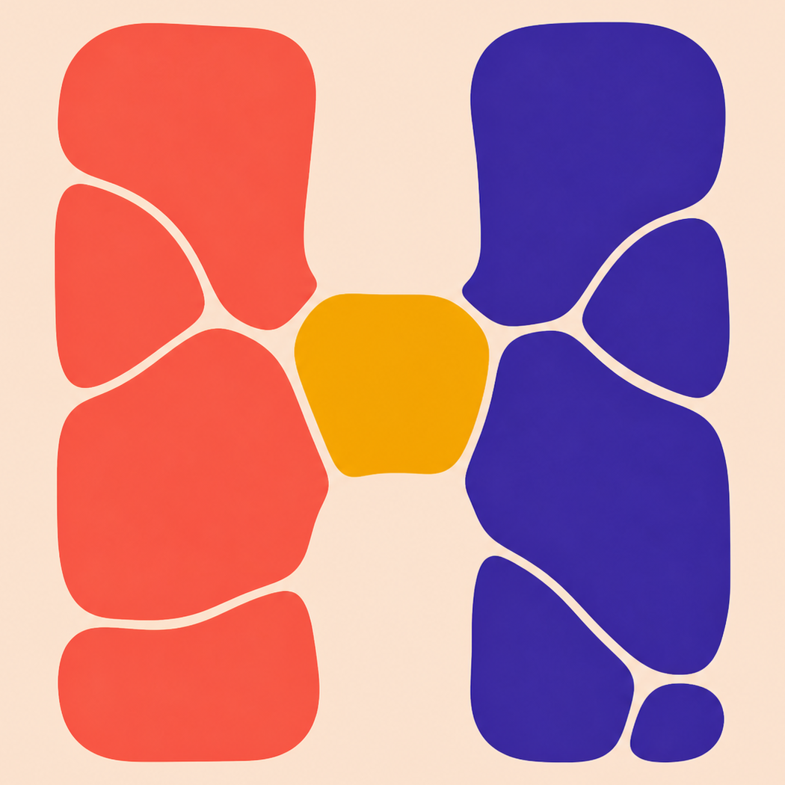
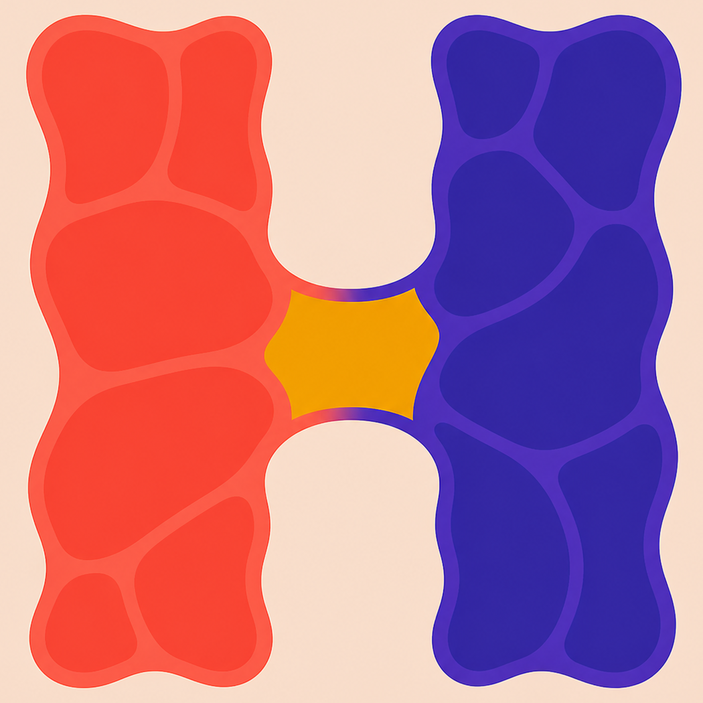
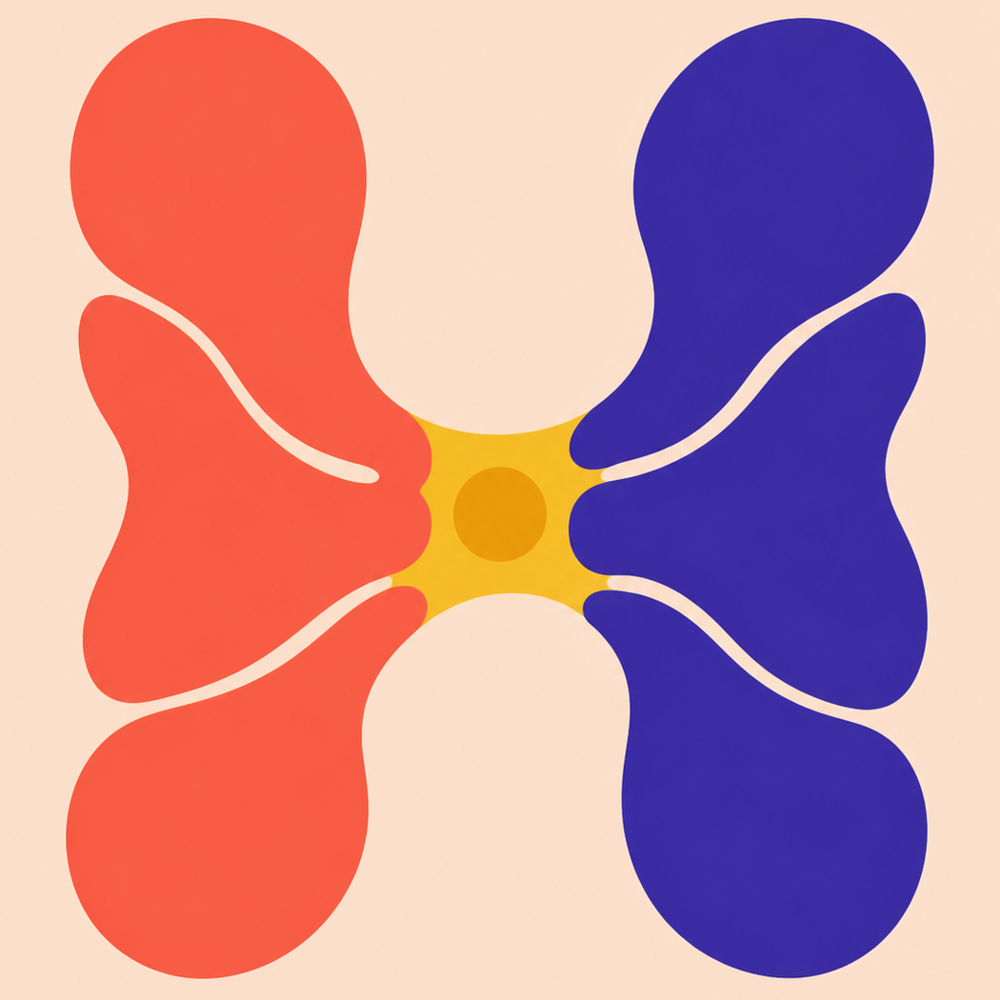

# Living H favicon studies — round 3

This round seeks the midpoint between the original cellular **Living H** and
the highly reduced geometric studies in round 2. The governing principle is
**compressed complexity**: the H must read first, while a small number of large
forms retain the ideas of living territories, growth, and emergence.

The full-size PNGs are concept renders with the same centered crop applied to
all four: 1254 px was trimmed to 1050 px, removing 102 px from every edge. This
leaves a thin favicon-appropriate margin without changing their relative
scale. The two preview directories contain real 32 px and 16 px reductions. A
selected concept should ultimately be redrawn and optically tuned rather than
auto-traced.

## 01 — Macrocell colonies

Two columns made from a handful of oversized cells. It preserves the original
colony metaphor strongly, but the cells separate enough that the H becomes
less immediate at 16 px.

32 px: 
16 px: 

## 02 — Membrane territories

The strongest balance in this round. One continuous, bold H carries broad
cellular compartments inside its coral and violet territories. At 16 px the
detail becomes texture without destroying the letter; at 32 px it reads as
living organization.

32 px: 
16 px: 

## 03 — Fused colonies

Two growing bodies meet around a gold nucleus. It is organic and distinct, but
its bilateral lobes can suggest a butterfly or chromosome before an H.

32 px: 
16 px: 

## 04 — Ecotone H

The most disciplined asymmetric study. Cellular divisions remain prominent on
the coral side while the violet side consolidates into a computational-looking
territory. The generated version only partly realizes the intended graph
transition, but its economy is useful.

32 px: 
16 px: 

## Recommendation

Advance **02 — Membrane territories**. In the production redraw, preserve the
continuous H silhouette, the broad coral-to-gold-to-violet transition, and
roughly five large compartments per upright. Flatten the incidental rendering
gradients, simplify the internal seams slightly, and create dedicated 16 px
and 32 px exports rather than relying on automatic downsampling.

The exact built-in image-generation prompts are archived in
[prompts.md](prompts.md).
